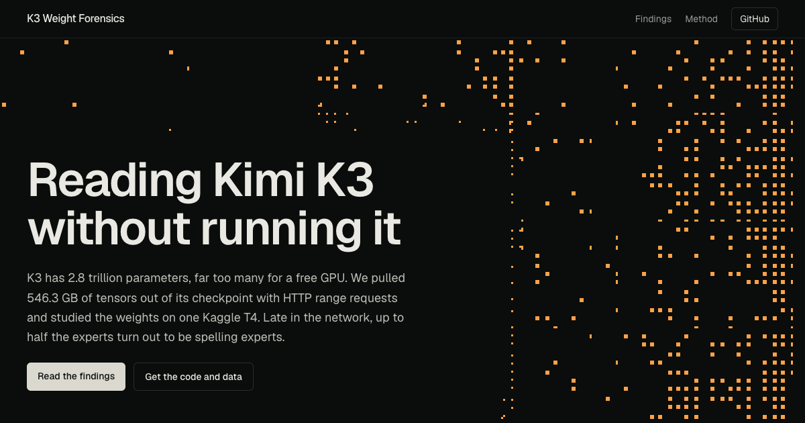

# Kimi K3 Weight Forensics

Six findings from reading [Kimi K3](https://huggingface.co/moonshotai/Kimi-K3)'s checkpoint directly, without ever running the model.

K3 is a 2.8-trillion-parameter mixture-of-experts model. Its weights are 1.56 TB, far more than any free GPU can hold. This project pulls individual tensors out of the published safetensors files with HTTP range requests (546 GB in total) and studies them on a single free Kaggle T4. Both runs together took 93 minutes of GPU time.

**Site:** https://arjunkshah12345-hash.github.io/kimi-k3-forensics/



## Findings

| Finding | Headline number | Where it comes from |
| --- | --- | --- |
| Late experts become spelling experts | 1% of experts in layers 1–47, 29% in layers 82–91, 48% at layer 89 | All 82,432 routed experts, decoded from MXFP4 |
| Only 16 tokens were never trained | 16 of 163,584 BPE tokens; 0 on the output side | Input and output embedding matrices |
| Linear-attention memory gets longer with depth | median half-life 4 tokens (layer 0) to 117 tokens (layer 86) | `A_log`, `dt_bias` of all 69 KDA layers |
| No two experts are alike | most similar pair of 2,688 experts: cosine 0.24 | Every expert of layers 1, 46, 91, run on 4,096 real token inputs |
| The load-balancing bias mostly says no | down to −0.76 (layer 90), boosts never above 0.15 | `e_score_correction_bias` of all 92 MoE layers |
| Checkpoint quirks | `A_log` stores 128 values for 96 heads; attention-residual queries cluster in blocks of 12 | Small per-layer tensors |

### 1. Late experts become spelling experts

For every routed expert we computed the direction it writes most strongly: the top singular vector of `W_up · diag(norm) · W2_e`, where `W2_e` is the expert's down projection and `W_up` is the shared latent-to-hidden projection (K3 runs its routed experts in a 3,584-dimensional latent space). We pushed that direction through the final norm and the unembedding and read off the top 10 tokens at each end.

An expert counts as a **spelling expert** when at least 5 of the top 10 tokens share one letters-and-digits core after lowercasing: ` java`, `-java`, `_java`, `(java`, `Java`, ` JAVA` all reduce to `java`.

| Layers | Share of spelling experts |
| --- | --- |
| 1–47 | 1.4% |
| 48–59 | spikes to 44% at layer 59 |
| 60–75 | back to 1–6% |
| 76–91 | 3.5–48%, peak 47.9% at layer 89 |
| 92 (last) | 1.2% |

Examples (orange end / opposite end of the same direction):

| Layer · expert | Promotes | Opposite end |
| --- | --- | --- |
| 56 · 743 | ` java` `-java` `java` `(java` `_java` `Java` | ` Clifford` ` meshes` `Mesh` |
| 84 · 757 | ` kg` ` pound` `kg` `KG` `Kg` ` KG` `公斤` | ` META` ` meta` `_meta` |
| 72 · 457 | ` onto` ` into` `into` `onto` `.into` ` INTO` | ` fins` ` dearly` |
| 90 · 33 | `-h` `/h` `'h` `\th` `,h` `-H` `_H` | ` Hatch` ` Herald` |

Raw per-layer scores: `results/v2/writer_lex_L*.npy`; top tokens for every expert: `results/v2/writer_tops_L*.json`.

### 2. Only 16 tokens were never trained

The usual way to find under-trained "glitch" tokens ([Land & Bartolo, 2024](https://arxiv.org/abs/2405.05417)) uses never-used reserved tokens as a reference, assuming their rows drift toward a shared direction during training. **That assumption fails on K3.** Its 240 reserved rows are still pure random initialization: kurtosis 3.01 (an exact Gaussian), norms equal to the mean, and pairwise cosine 0.004. The reference-direction method therefore ranked spaces and commas as the most "untrained" tokens (kept in `results/v1/glitch_candidates.json` as a negative result).

Nearest-neighbour cosine works instead. A trained token has close neighbours (median 0.46 on the input side, 0.64 on the output side), and an untrained row looks like noise (about 0.05). Using the 99th percentile of the reserved rows (0.062) as the threshold:

- **13 tokens** are single bytes that can never occur in valid UTF-8: `0xC0`, `0xC1`, `0xF5`–`0xFF`. They're the expected sanity check.
- **2 tokens** are an adjacent pair, ids 57118 and 57119: `\tPnapi` and `\tBmori`. They read like genome-annotation species codes (*Pieris napi*, *Bombyx mori*) that reached the tokenizer's training corpus but not the model's.
- One more, id 1699 `о\xd0`, is a broken Cyrillic byte pair.

The unembedding has **zero** untrained BPE tokens. Input and output embeddings are untied (mean row cosine 0.004).

### 3. Kimi Delta Attention memory gets longer with depth

69 of 93 layers use Kimi Delta Attention (KDA), a gated linear attention whose state decays per channel. With the lower-bounded gate K3 uses, the per-step log-decay is

```
g = lower_bound · sigmoid(exp(A_log[h]) · (f(x) + dt_bias))      lower_bound = −5
```

Setting the input-dependent part `f(x)` to 0 gives each channel's resting decay. `ln 2 / |g|` turns it into a half-life in tokens. The median half-life over each layer's 12,288 channels rises from 4.4 tokens at layer 0 to 117 at layer 86. Across all layers, 8.6% of channels have a resting half-life over 1,000 tokens, and a few effectively never decay. Data: `results/v1/kda_halflife.npy` (69 × 96 × 128).

### 4. No two experts are alike

We decoded every expert of layers 1, 46 and 91 (896 each) from MXFP4 and ran it on the same 4,096 real token inputs: embedding → the layer's RMSNorm → the shared latent down-projection → expert. Each expert's 4,096 × 3,584 output was randomly projected to 256 dimensions, and every pair of experts was compared by centred cosine.

| Layer | Most similar pair | Typical nearest neighbour |
| --- | --- | --- |
| 1 | 0.066 | 0.008 |
| 46 | 0.008 | 0.004 |
| 91 | 0.236 | 0.016 |

There are no near-duplicate experts to merge.

The MXFP4 nibble order validated itself. Decoding low-nibble-first gives responses to real inputs 12% stronger than to matched noise; the other order gives 0.2%, as unstructured weights would.

### 5. The load-balancing bias mostly says no

K3 uses auxiliary-loss-free balancing: a per-expert bias (`e_score_correction_bias`) is added to the sigmoid router scores only when choosing the top 16. The bias is effectively a record of how unbalanced the router was during training. Early layers stay within about ±0.15. Deep layers push over-popular experts down hard, as far as −0.76 at layer 90 (router scores live in [0, 1]), while the largest boost anywhere is 0.15.

### 6. Smaller things

- **`A_log` padding.** Every KDA layer stores `A_log` with 128 values, but there are 96 heads. The kernel reads the first 96, and the last 32 are exactly zero. Strict shape-checking loaders will reject it.
- **Attention residuals have block structure.** Each layer has two 7,168-d "depth queries" (`self_attention_res_proj`, `mlp_res_proj`) that attend over earlier layers' outputs. Their cosine similarity is 0.35 within the same 12-layer block versus 0.16 across blocks, matching `attn_res_block_size: 12`.

## What didn't work

- **Embedding-level routing maps.** Routing raw token embeddings through each router, to see which tokens "own" which expert, is only meaningful at layer 1, since deeper routers see contextual states. On raw embeddings the balancing bias made load *less* even in 91 of 92 layers, which shows those inputs are far from what the routers were tuned on. The maps are kept in `results/v1/route_emb_L*_top16.npy` but are not used as evidence.
- **Expert logit lens on embedding probes.** Mean expert outputs on embedding inputs, read through the unembedding, were noise past layer 1. The weight-only write-direction method in finding 1 replaced it.
- **First Kaggle run.** It ran out of memory: the T4 exposes 14.5 GB, not 16. Chunked matrix math fixed it.

## How it works

A safetensors file is an 8-byte little-endian header length, a JSON header mapping each tensor name to its dtype, shape and byte offsets, then raw data. Hugging Face serves model files with HTTP range support, so:

```python
n = struct.unpack("<Q", get_range(shard, 0, 7))[0]       # header length
header = json.loads(get_range(shard, 8, 7 + n))          # tensor directory
start, end = header[name]["data_offsets"]
tensor = get_range(shard, 8 + n + start, 8 + n + end - 1)  # just that tensor
```

The scripts resolve each shard's CDN URL once, retry and re-sign on 403/503, coalesce adjacent tensors into ~96 MB chunks and download them on 12–24 threads while the GPU works. Kaggle sustained about 100 MB/s.

K3's routed experts are **MXFP4** (compressed-tensors `mxfp4-pack-quantized`): `weight_packed` is `uint8 [out, in/2]` holding two E2M1 codes per byte, low nibble first, and `weight_scale` is `uint8 [out, in/32]`, an E8M0 exponent per group of 32. Dequantization is a 16-entry lookup times `2^(scale − 127)` (`dequant()` in the scripts).

What was downloaded:

| Run | What | Size | Time |
| --- | --- | --- | --- |
| v1 | embeddings, lm_head, all routers and biases, all KDA gates, attention-residual queries, every expert of layers 1/46/91 | 53.5 GB | 11.5 min |
| v2 | embeddings, lm_head, routers, and `w2` of all 82,432 experts | 492.8 GB | 81 min |

## Reproduce it

Requirements: a Kaggle account with phone verification (for GPU and internet). The scripts need only `torch`, `numpy` and `requests`, all preinstalled on Kaggle.

```bash
pip install kaggle   # then put your API token in ~/.kaggle
# 1. set your username in experiments/kaggle/v1/kernel-metadata.json and v2
# 2. push each run as a private GPU kernel
mkdir -p /tmp/k3v1 && cp experiments/run_v1.py /tmp/k3v1/run.py && cp experiments/kaggle/v1/kernel-metadata.json /tmp/k3v1/
kaggle kernels push -p /tmp/k3v1
mkdir -p /tmp/k3v2 && cp experiments/run_v2.py /tmp/k3v2/run.py && cp experiments/kaggle/v2/kernel-metadata.json /tmp/k3v2/
kaggle kernels push -p /tmp/k3v2
# 3. when they finish, download outputs
kaggle kernels output YOUR_KAGGLE_USERNAME/k3-weight-forensics -p results/v1
kaggle kernels output YOUR_KAGGLE_USERNAME/k3-weight-forensics-v2 -p results/v2
# 4. rebuild the site data
python3 analysis/build_findings.py
```

`experiments/smoke_v1.py` and `smoke_v2.py` exercise the fetching and MXFP4 decode locally on CPU in a few minutes, using a handful of experts.

## Repository layout

```
experiments/   run_v1.py, run_v2.py (the Kaggle jobs), smoke tests, Kaggle kernel metadata
results/v1/    raw outputs of run 1 (results.json, .npy arrays, kernel log)
results/v2/    raw outputs of run 2
analysis/      build_findings.py: raw results -> site/src/data/findings.json
site/          the website (Vite, React, Tailwind v4, Dither Kit charts, a dithercn hero)
launch/        launch video source (HyperFrames)
social/        launch post drafts
```

## Caveats

- **Static analysis only.** Nothing here runs a full forward pass. "Resting" KDA half-lives ignore the input-dependent gate, and expert write directions describe what an expert can write, not how often it is routed.
- **The spelling-expert test is a heuristic.** The threshold (5 of top 10 sharing a core) is ours, and so is the alphanumeric core rule. CJK-only families are partially covered.
- **Embedding probes stand in for real inputs.** The expert similarity experiment feeds normalized token embeddings rather than contextual hidden states.

## Credits and license

Code, analysis and findings: MIT. Kimi K3 weights, tokenizer and modeling code are © Moonshot AI under the Kimi K3 License. None of them are redistributed here; the scripts download individual tensors from Hugging Face at run time.

The site's charts are built with [Dither Kit](https://tripwire.sh/dither-kit) by Boring Software, and its hero with [dithercn](https://dithercn.dev) by [@leodev](https://x.com/leodev).
